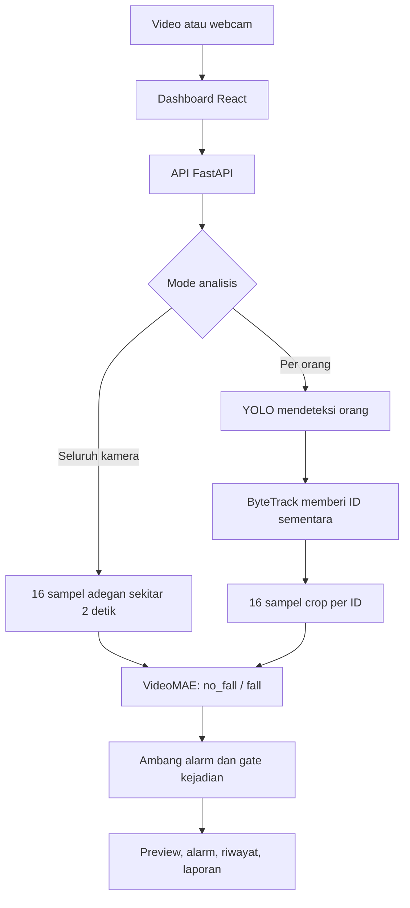

# Fall Detection Dashboard

Aplikasi web untuk menganalisis dugaan orang jatuh dari video atau webcam,
menggunakan **React**, **FastAPI**, **YOLO**, **ByteTrack**, dan **VideoMAE**.
Dashboard menampilkan preview, prediksi, alarm, serta riwayat hasil yang dapat
ditinjau dan diunduh.

**Status:** prototipe lokal untuk eksperimen dan pelaporan. Source aplikasi
terdapat di folder [`fall-human-merged/`](fall-human-merged/). Bobot model,
dataset, dan hasil analisis tidak disimpan di repository GitHub.

## Fitur

- Upload video MP4, AVI, MOV, MKV, atau WebM; batas upload backend 500 MB.
- Membuka webcam yang terhubung ke mesin backend.
- Memilih analisis seluruh kamera atau analisis per orang.
- Preview hasil, statistik proses, log alarm, dan suara pengingat.
- Riwayat sesi, tinjauan alarm, penandaan jatuh/alarm palsu, dan unduh laporan.
- Penyimpanan prediksi/alarm CSV, ringkasan JSON, dan video anotasi bila diaktifkan.

## Cara kerja



| Mode | Penggunaan | Batas hasil |
|---|---|---|
| **Seluruh kamera** — default | Mengklasifikasikan adegan penuh sesuai bentuk input training VideoMAE | Tidak menjalankan YOLO/ByteTrack dan tidak menentukan siapa yang jatuh |
| **Per orang** — eksperimen | YOLO → ByteTrack → crop per ID → VideoMAE | Crop berbeda dari training adegan penuh; akurasi dan kestabilan identitas perlu dievaluasi tersendiri |

ByteTrack adalah tracker, bukan model klasifikasi jatuh. ID yang dihasilkan
bersifat sementara dan dapat berubah ketika orang tertutup, hilang, atau muncul lagi.

## Model dan pengaturan saat ini

| Komponen | Konfigurasi |
|---|---|
| Detector | `YoloDetector.pt`, task `detect`, kelas `0 = person` |
| Tracker | ByteTrack, konfigurasi `tracker.yaml` |
| Classifier | VideoMAE Le2i + CAUCAFall, checkpoint epoch 4 (`mixed_fine_tuning`) |
| Label | `no_fall` dan `fall` |
| Input VideoMAE | 16 frame RGB sekitar 2 detik; letterbox hitam 224×224 |
| Jeda pengajuan klip | 0,5 detik waktu sumber |
| **Ambang alarm aplikasi** | **70%**, di `action_config.py` |
| Ambang validation pada ekspor | 58%; metadata ekspor tetap dipertahankan |
| Konfirmasi awal | 1 hasil yang memenuhi ambang |
| Ukuran input YOLO aplikasi | 416; metadata training YOLO mencatat 640 |
| Batas analisis per orang | 6 orang secara default |

Skor 70% adalah ambang keputusan aplikasi, bukan jaminan akurasi 70% atau
probabilitas kejadian yang sudah terkalibrasi. Label positif mencakup gerakan
jatuh atau keadaan setelah jatuh. Model tidak memiliki kelas `lying` tersendiri.

## Instalasi dan menjalankan

Siapkan **Git**, **Python 3.12** yang disarankan oleh launcher, serta **Node.js/npm**.
Script setup menerima Python 3.10–3.13 dan memasang runtime PyTorch CPU.

### 1. Ambil source

Jalankan dari folder kerja pilihan masing-masing:

```powershell
git clone --branch main https://github.com/Rai710/fall-human.git
Set-Location .\fall-human\fall-human-merged
```

Jika sudah mempunyai clone, gunakan folder tersebut dan pastikan branch/versi
yang dibuka sesuai kesepakatan tim.

### 2. Lengkapi bobot model

Minta kedua paket model kepada penanggung jawab model, lalu tempatkan seperti ini:

```text
fall-human-merged/
└── models/
    ├── YoloDetector.pt
    └── best_model-20261025T045257Z-1-001/
        └── best_model/
            ├── model.safetensors
            ├── config.json
            ├── preprocessor_config.json
            ├── inference_config.json
            ├── export_complete.json
            └── seluruh berkas pendukung paket ekspor
```

Salin **seluruh isi paket `best_model`**, bukan hanya bobot. Loader memeriksa hash
berkas ekspor. Lokasi detector diatur di `model_config.json`; lokasi classifier
ditentukan oleh `action_config.py` dan `mixed_model_config.py`.

Clone GitHub tidak membawa bobot karena folder `models/` diabaikan Git. Dashboard
memakai classifier lokal; upload ke Model Hub dan penyediaan API cloud adalah
pekerjaan terpisah. Tautan unduhan bobot tim belum dicantumkan di repository ini.

### 3. Pasang dependensi dan buka dashboard

```powershell
.\setup_dashboard.cmd
.\run_dashboard.cmd
```

Buka **http://localhost:8000**. Setup pertama membutuhkan internet untuk paket
Python/npm. Launcher membangun React jika `frontend/dist` belum tersedia.
Kamera baru dibuka setelah pengguna memulai sesi webcam.

Pada komputer pengembang yang sudah disiapkan, launcher juga dapat membaca
interpreter dari `local_python.txt`. File tersebut khusus mesin lokal dan tidak ikut Git.

### 4. Coba analisis video

1. Pilih **Upload video** dan pilih berkas.
2. Mulai dengan **Seluruh kamera** untuk input yang sesuai training classifier.
3. Biarkan simulasi live mati agar setiap jendela terjadwal diproses secara offline.
4. Klik **Mulai monitoring** dan tunggu proses selesai.
5. Buka **Riwayat** untuk membaca hasil, memberi tinjauan, atau mengunduh laporan.

Preview offline dapat berhenti sejenak saat menunggu inferensi. Video hasil
tersedia jika **Simpan video anotasi** diaktifkan dan penulisan/konversi berhasil.

## Struktur repository

```text
README.md                          # Panduan aplikasi
PEMBAGIAN_TUGAS.md                  # Usulan tanggung jawab tiga anggota
fall-human-merged/
├── frontend/                      # React, TypeScript, Vite
├── backend/                       # API, sesi, streaming, riwayat
├── action_config.py               # Profil classifier dan ambang aplikasi
├── mixed_model_config.py          # Validasi ekspor dan preprocessing biner
├── detector_config.py             # Sumber dan konfigurasi YOLO
├── pose_engine.py                 # Analisis seluruh kamera / loader VideoMAE
├── person_engine.py               # YOLO, ByteTrack, dan analisis per orang
├── live_core.py                   # Buffer, antrean klip, gate alarm
├── person_core.py                 # Penjadwalan pekerjaan per orang
├── tracker.yaml                   # Pengaturan ByteTrack
├── tests/                         # Tes integrasi dan regresi
└── INTEGRASI_MODEL.md             # Catatan implementasi dan hasil uji
```

Panduan perintah pengembangan/API ada di [README teknis](fall-human-merged/README.md).

## Pengujian dan batas penggunaan

Pada integrasi awal, **45 tes otomatis lolos** dan build React berhasil. Setelah
ambang aplikasi dinaikkan menjadi 70%, **10 tes API/integrasi terkait lolos**.
Tes otomatis tersebut memeriksa perilaku program, bukan akurasi deteksi.

Uji satu video lokal dengan model asli pada **ambang awal 58%** menghasilkan:

| Mode | Frame dibaca/disimpan | Klip dianalisis | Alarm |
|---|---|---|---|
| Seluruh kamera | 203 / 203 | 9 | 1 |
| Per orang | 203 / 203 | 9 | 2 |

Pada mode per orang, terbentuk dua ID sepanjang rekaman. Dua alarm tidak boleh
langsung dihitung sebagai dua kejadian jatuh. Angka di atas bukan evaluasi ulang
akurasi pada threshold 70%. Rincian ada di [catatan integrasi](fall-human-merged/INTEGRASI_MODEL.md).

Batas yang masih perlu diperhatikan:

- Rebah di kasur pernah salah diprediksi sebagai `fall`; webcam close-up juga belum tervalidasi.
- Orang kecil/jauh, tertutup, atau berbeda sudut dari data training dapat terlewat.
- CPU membutuhkan sekitar 1,5–2,4 detik per klip pada contoh uji; preview lancar tidak menjamin alarm tepat waktu.
- Webcam index membuka kamera mesin backend, bukan otomatis kamera browser pengunjung.
- Ada laporan webcam gagal karena timestamp berulang; perbaikannya belum diterapkan dalam versi ini.
- Satu sesi aktif per proses backend; sesi tambahan ditolak, bukan diantrikan sebagai pekerjaan pengguna.
- Deployment cloud, streaming kamera browser, dan penyimpanan cloud belum tersedia.

## Tim dan pembagian tugas

| Nama | Tanggung jawab |
|---|---|
| **Raihan Buono** | Model deteksi jatuh VideoMAE: persiapan data Le2i + CAUCAFall, fine-tuning, preprocessing, threshold, dan evaluasi jatuh/nonjatuh |
| **Michael** | Detector orang YOLO dan tracking ByteTrack: bobot detector, konfigurasi deteksi, kestabilan ID, dan evaluasi orang yang terlewat |
| **Rioo** | Frontend React: tampilan dashboard, upload video, preview, tampilan alarm, riwayat, serta interaksi pengguna |

Integrasi backend/API, pengujian sistem, dan penyusunan laporan dikerjakan
bersama. Rincian koordinasi dan hasil kerja tiap bagian tersedia di
[PEMBAGIAN_TUGAS.md](PEMBAGIAN_TUGAS.md).

## Lisensi

Checkpoint dasar VideoMAE mencantumkan **CC BY-NC 4.0**; Ultralytics menggunakan
**AGPL-3.0** atau lisensi komersial yang sesuai. Dataset dan bobot detector custom
memiliki ketentuan asal masing-masing. Repository ini belum menetapkan satu
lisensi baru yang mencakup seluruh source dan bobot tim.
